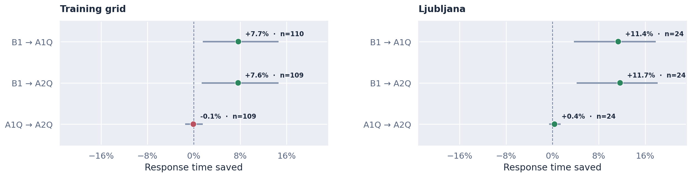

<p align="center"></p>
<h1 align="center">RescueFlow AI</h1>
<p align="center"><strong>Emergency transport replanning in a live Ljubljana simulation</strong></p>
<p align="center">
  <a href="#demo-video">Demo video</a> ·
  <a href="#quick-start">Quick start</a> ·
  <a href="#watch-in-sumo-2d">SUMO 2D demo</a> ·
  <a href="#benchmark-results">Benchmark results</a> ·
  <a href="docs/README.md">Documentation</a>
</p>

Built for Epilog’s emergency transport challenge at AdaHack 2026. RescueFlow helps a dispatcher respond when an ambulance breaks down, an urgent call arrives, or a route closes. It compares feasible changes to the current schedule and shows the expected response times and impact on existing assignments.

The dispatcher approves a plan, the console logs a mock crew message, and Eclipse SUMO executes the routes. Urgent ambulances can request simulated signal priority. The Ljubljana map uses OpenStreetMap roads and a GURS orthophoto. Calls, traffic and operations are simulated. [Map data and attribution](docs/INTEGRATIONS.md#native-ljubljana-presentation)

## Demo video

<a href="https://www.youtube.com/watch?v=53igKEtEEZQ"></a>

[Watch on YouTube](https://www.youtube.com/watch?v=53igKEtEEZQ)

## Quick start

Install Python 3.11+, Node.js 22 and Eclipse SUMO with its tools. From the repository root, run these Windows PowerShell commands:

```powershell
python -m venv .venv
.\.venv\Scripts\python.exe -m pip install -e '.[dashboard,dev]'
.\.venv\Scripts\rescueflow.exe doctor
.\.venv\Scripts\python.exe -m uvicorn rescueflow.dashboard.app:app --host 127.0.0.1 --port 8000
```

In a second shell at the repository root:

```powershell
npm --prefix frontend ci
npm --prefix frontend run dev -- --port 5173
```

Open the [dispatcher console](http://127.0.0.1:5173/). Press **F2** to report a prepared emergency call, compare the proposed routes, and approve one. **F9** opens training controls. The [demo script](docs/DEMO_SCRIPT.md) walks through a crew-reported breakdown, route changes and the crew notification.

The console runs without an API key and labels its rule-based fallback. For OpenAI setup or SUMO troubleshooting, see the [runbook](docs/RUNBOOK.md).

## Watch in SUMO 2D

Open the city-wide scene with 10 ambulances and eight emergency calls. The two windows share the same fleet, calls and traffic so you can follow how each dispatch policy responds.

```powershell
.\.venv\Scripts\python.exe -m rescueflow.sumo.presentation compare
```

Use `baseline` or `rescueflow` in place of `compare` to open one window. See the [SUMO legend and controls](docs/RUNBOOK.md#native-sumo-2d-presentation) or download the [offline replay](experiments/published/replay.html) for a recorded training-grid run.

## Benchmark results

Across 680 synthetic SUMO runs, 667 passed the audit. The table compares the central-queue baseline (**B1**) with AI-ranked, queue-aware dispatch and signal priority (**A2Q**) on valid matched scenarios.

| Network | Matched scenarios | Mean response, B1 → A2Q | Time saved | Reached within 5 min, B1 → A2Q |
| --- | ---: | ---: | ---: | ---: |
| Training grid | 109 | 192.0 → 177.3 s | **7.6%** | 81.8% → 86.3% |
| Ljubljana | 24 | 271.6 → 239.9 s | **11.7%** | 68.0% → 74.2% |



Mean response uses observed SUMO arrivals, capped at 15 minutes, with the same 15-minute score assigned to missed calls. Intervals for adding signal priority to AI-ranked dispatch (**A1Q → A2Q**) span zero on both maps. The [experiment notes](docs/EXPERIMENTS.md) cover the separate corridor tests, civilian effects, data and reproduction commands.

## Explore the repository

| Path | What you’ll find |
| --- | --- |
| [`src/rescueflow/`](src/rescueflow/) | FastAPI, event validation, planning, approval, SUMO controller and benchmark runners |
| [`frontend/`](frontend/) | React and TypeScript dispatcher workstation |
| [`simulation/`](simulation/) | Scenario fixtures, road extracts and native SUMO presentation assets |
| [`experiments/published/`](experiments/published/) | Measured summaries, charts and offline replay |
| [`tests/`](tests/) | Planner, API and real SUMO integration tests |
| [`docs/`](docs/README.md) | Demo, operations, design and evaluation guides |

```powershell
.\.venv\Scripts\python.exe -m pytest tests/ -q
```
