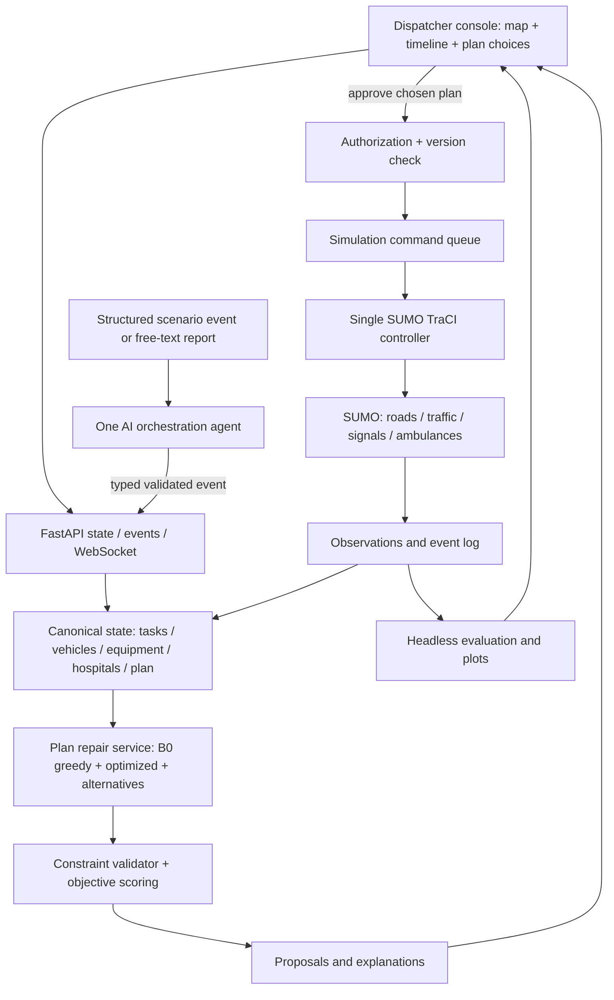

# RescueFlow AI — AdaHack 2026 development plan (v3)

**Status:** source-of-truth implementation specification, revised after practitioner interview  
**Prepared:** 21 November 2026  
**Challenge:** *Epilog — Izziv 3: AI-agenti za obvladovanje nepričakovanih dogodkov pri reševalnih prevozih*  
**Scope:** synthetic transport logistics and SUMO traffic simulation. This is **not** an operational emergency dispatch system, a clinical decision system, or an authorization to control real traffic lights.

> **One-sentence brief:** Enhance the existing dispatcher-to-crew workflow: start from a valid transport plan; receive a new call or crew-reported disruption; let an AI orchestrator validate the event and request constrained plan repair; let a dispatcher choose/approve a feasible alternative; notify the simulated unit (which keeps external navigation, such as Google Maps, in production); execute the authorized plan in SUMO; evaluate it against a competent conventional rule-based dispatch-and-repair baseline.

---

# 0. Decisions to lock before coding

| Decision | Locked choice | Why |
|---|---|---|
| Primary product | **Disruption-aware transport replanning** | This is the actual challenge, not generic first-response dispatch. |
| Primary user | **Human dispatcher/operator** | Epilog explicitly asks for an AI assistant proposing the next action to an operator; practitioner feedback confirms dispatchers remain the communication hub. |
| Initial plan | **Pre-generated shared schedule** of patient and equipment jobs, priorities, time windows | Allows visibly meaningful *old plan → event → repaired plan*. |
| Core simulator | **Eclipse SUMO + TraCI** for road vehicles, civilian traffic and signals | Open-source, programmable microscopic simulation. |
| Planning | **Deterministic heuristic first, OR-Tools if useful** | Gives a reliable reference policy and constrained improvements without training an ML model. |
| AI | **One tool-using agent / event interpreter, backed by validated backend tools** | Actual orchestration, but no made-up state or uncontrolled actuation. |
| Green wave | **Feature, not product core**; safe phase switching on a few junctions | Valuable demonstration but not central to Epilog's acceptance criteria. |
| Equipment handoff | **One simplified cargo transfer dependency** | Explicitly requested on the poster; demonstrates nontrivial logistics. |
| Helicopter | **Abstract planning resource** with weather/availability and flight ETA | Challenge includes helicopters; SUMO is not a flight simulator. |
| Repositioning | **Optional, separate experiment** | Conceptually useful but not necessary to show schedule repair. |
| Human control | **Operator chooses and approves a feasible plan**; automatic observation/planning | Appropriate for consequential dispatch; autonomous mode only in synthetic simulation. |
| Existing navigation | **Keep crew Google Maps workflow in production**; simulated `NavigationAdapter` in MVP | The field interview describes directions being opened for crews automatically; no reason to replace navigation or acquire a Google routing key. |
| Main UI | **Dispatcher dashboard with map + before/after timeline + plan cards + simulated outbound dispatch message** | Matches observed call → dispatch → crew navigation and crew problem → dispatcher → plan-repair workflows. |
| Evaluation | **Two independent suites:** logistics repair and green-wave traffic; optional integrated showcase | Avoid attributing all gains to a single feature or selecting a weak baseline. |
| Code scope | One React frontend, one Python backend/runner, internal dispatch notification adapter; **no Google Maps API or crew app** | Simulated navigation uses SUMO; existing Google Maps navigation remains unchanged in the future workflow. |
| Geographic scope | Clearly labeled **fictional 7×7 road grid**, not a calibrated Slovenian city | Fast and reproducible, with no false claim about national performance. |

**New field rule (v3):** The dispatcher remains the decision-maker and the crew keeps its existing navigation app. RescueFlow makes dispatch choices and disruption repair better; the sim uses fictional roads with no Google key.

**Project rule:** Do not trade away the full replanning lifecycle, task constraints, baseline fairness, or actual simulation results to add more decorative features.

---

# 1. Rechecking the real challenge — requirements traceability

## 1.1 What the organizer actually says

The organizer's supplied description requests an AI assistant that, upon an unexpected event in rescue transports, **analyzes the situation, evaluates the consequences, and proposes the best next action to the operator**. Examples are vehicle delay, closed road, breakdown, sudden intervention, shortages, and urgent patient transport.

The attached Epilog poster gives a more concrete specification:

1. **"Pripravite plan"** — prepare an initial plan with tasks such as *patient transport, equipment transport, urgent driving*; a fleet of *rescue vehicles and helicopters*; *hospital/center* destinations; and constraints: *vehicle capacities, time windows, task priorities*.
2. **"Plan se spremeni. Kaj zdaj?"** — handle *vehicle breakdown*, *fog grounding a helicopter for one hour*, *a new urgent task*, *reduced receiving-center capacity*, and *changed priority due to worsening patient condition*.
3. **"Ustvari rešitev, dodaj AI pri reševanju primera"** — demonstrate an AI assistant translating **natural-language messages into an event that triggers an appropriate change of plan**. Example: *"Vozilo je obstalo. Oprema je še v njem."*
4. **"Realne omejitve"** — *vehicle capacity, time windows, priority, multiple trips, equipment pickup/delivery, road paths, helicopter air distance (200 km/h)*, optionally crew availability, landing site availability, and receiving-site capacity. The example explicitly requires **another vehicle to collect equipment from the broken-down vehicle**.
5. Final expected demonstration: *initial plan → unexpected event → new plan*.

This means a solution that optimizes only a new emergency call and turns traffic signals green would be **incomplete**. The corrected product centers on logistics *plan repair*; an emergency response KPI is one part of the evaluation, not its entirety.

## 1.2 Coverage matrix — every requested concept has a defined treatment

| Poster requirement | MVP implementation | Demo / test evidence | Scope |
|---|---|---|---|
| Initial plan | 6–10 pickup/delivery tasks across 5 ambulances | Initial Gantt / route schedule | Must |
| Patients | Pickup → hospital, service/handling times, priority, capacity | Patient delivery status and ETA | Must |
| Equipment | Equipment asset attached to a vehicle; pickup/dropoff task | Cargo recovery after breakdown | Must |
| Emergency/new urgent task | New time-sensitive task injected during execution | Agent triggers replanning | Must |
| Multiple vehicle trips | Vehicle can serve more than one task sequentially | Before/after route sequences | Must |
| Vehicle breakdown | Mark unavailable; interrupt tasks; create recovery dependency | Central demo | Must |
| Vehicle capacity | Patient slots and equipment capacity / compatibility | Infeasible proposal rejected | Must |
| Time windows | Earliest/latest pickup/delivery and lateness tracking | Gantt + KPI | Must |
| Task priorities | Critical tasks ranked above routine | Alternate-plan trade-offs | Must |
| Roads/routes | SUMO network, dynamic travel time, detours | Ambulance physically reroutes | Must |
| Hospital/center | Destination and receiving slots/capacity | Change of receiving capacity as scenario | Must or compact extension |
| Helicopter | Mode-specific resource, flight ETA and weather availability | Fog blocks flight for one hour | Lightweight model |
| Changed patient priority | `priority_changed` event | Scenario picker or second scripted event | Lightweight model |
| AI natural language | LLM extracts typed event; tools validate and invoke planner | Free-text input plus event log | Must |
| Minimize effect on existing plan | Explicit plan-churn cost and locked commitments | Compare reassigned tasks | Must |
| Crew / landing site | Optional resource constraints, not fabricated real data | If implemented, validation tests | Stretch |
| Green-wave signals | Controllable SUMO intersections | Live signal and route demonstration | High-priority extension |
| Fleet repositioning | Demand-weighted idle staging | Separate exploratory evaluation | Stretch |

**Important boundary:** The poster includes helicopter transport at 200 km/h, but does not require visually simulating rotorcraft flight through SUMO. The planning layer can calculate helicopter availability and notional flight times; only road vehicles are simulated microscopically.

## 1.3 Practitioner feedback (21 November 2026) — primary workflow evidence

The user reports speaking to **an ambulance driver who was previously a dispatcher**. Treat this as valuable *qualitative field testimony*, **not** a verified description of every Slovenian EMS service or a quantified baseline:

1. A caller contacts dispatch. The dispatcher sees the closest available units and sends an assignment/message to a selected unit.
2. A crew member receives the task. The destination is populated into **Google Maps**, which the crew uses for navigation. We were not given the dispatch software/product name, API, dispatch selection rules, or an export of its data.
3. If an issue occurs during transport, the unit **notifies the dispatcher**, who handles it.

**Product implication:** RescueFlow is a **dispatcher-facing augmentation layer**. It should not ask crews to abandon Google Maps, build a custom turn-by-turn navigation app, pretend to connect to an unseen national dispatch API, or take over a real traffic light. It should integrate *upstream* of task assignment and *around* crew disruption reporting:

```text
Caller / scheduled transport / crew radio-message
  -> human dispatcher receives event
  -> RescueFlow recognizes/validates event, inspects current fleet and plan
  -> baseline or enhanced replanner proposes valid assignment(s)
  -> dispatcher chooses and approves a plan
  -> adapter sends task update to selected crew (mock message in demo)
  -> crew uses its normal navigation app (Google Maps in reported practice)
  -> simulated vehicle follows SUMO route, updates ETA/status
  -> exceptions flow back to dispatcher and trigger another planning cycle
```

**Why not automate dispatch by default?** The challenge says *"operaterju predlaga"* (proposes to the operator). Therefore, default to operator-approved changes; automatically monitor, interpret and compute. A `SIM_ONLY_AUTOPILOT` mode is permitted for controlled experiments, clearly labeled and never wired to real resources. An optional simulated `crew_acknowledged` event is realistic but **must not block** the demo if omitted.

**Google Maps integration decision:** No Google Maps SDK or billing project is needed. A production `NavigationHandoff` may use an existing CAD/MDT integration or, where appropriate, a **Google Maps URL** (`https://www.google.com/maps/dir/?api=1&destination=...`), for which the official documentation says **no API key is required**. This only opens navigation; it is **not** a free Google Maps route-matrix or live traffic API. Do not send patient names, medical details, or other sensitive case data inside such URLs. For the synthetic hackathon grid, there are no real-world geographic destinations to open in Google Maps; use a mock dispatch notification and SUMO network routing instead.

**Baseline correction:** The reference must reflect credible practical behavior: closest *available and suitable* unit, dispatch message, crew mobilization, route guidance, and manual exception handling represented by a clearly specified rule-based replanner (with the same input knowledge, constraints and approval-delay assumptions as the AI policy). Never claim the implemented baseline is precisely the actual Slovenian system or infer real human-dispatcher latency from a single interview.

## 1.4 Questions to mentors — useful, but do not block implementation

- Are they targeting **scheduled patient/equipment transports**, urgent ambulance dispatch, or both? The poster strongly suggests **both**, with plan repair as the common denominator.
- Do they expect a formal optimal solution or a feasible improved plan with transparent trade-offs? The challenge wording says *best next action*, not a mathematical proof of global optimality.
- Is there a preferred benchmark/data format? No official dataset, metric definition, public API or integration specification was present in the provided material.
- Is equipment transfer or helicopter scheduling particularly important for judging? The poster calls attention to both; we include minimal versions either way.

We do **not** claim the screenshot is a complete written competition rulebook. The public AdaHack event site verifies the event context but did not expose a more detailed technical rubric at review time.

---

# 2. What exists, what to reuse, what to build

## 2.1 Product/library inventory and decisions

| Existing system | Public availability / purpose | Adopt? | Rationale |
|---|---|---|---|
| **Eclipse SUMO** | Open-source microscopic road/traffic/intersection simulator | **Yes** | Replaces enormous traffic simulation effort. |
| **TraCI + sumolib** | Official Python interfaces to SUMO state and controls | **Yes** | Movement, routing, signals, events, experiment telemetry. |
| **SUMO netgenerate / randomTrips** | Generate synthetic roads and civilian traffic | **Yes** | Reproducible map and traffic quickly. |
| **OR-Tools** | Open-source routing/scheduling with pickups, capacity, time windows | **Yes, once core loop works** | Faster than coding a full general vehicle routing solver. |
| **Resgrid Core / Dispatch** | Apache-2.0 open-source emergency CAD with documented API and dispatcher interface | **No, for 24h** | An entire server stack is unnecessary and its data model is not the core innovation. Good future API target. |
| **Traccar** | Open-source vehicle GPS platform with API | **No** | SUMO already produces precise synthetic vehicle positions; extra infrastructure adds no benefit. |
| **OSRM / Valhalla** | Open-source map routing services | **No, for a synthetic grid** | SUMO/sumolib can provide route geometry and estimates on the same graph. |
| **IS DSZ / IS NMP (Slovenia)** | National medical dispatch and emergency information projects | **No direct integration** | Public government sources describe the systems, but no public third-party dispatch-replanning API/open-source code was verified. |
| **Slovenian National Access Point (NAP)** | Public traffic datasets/transport information | **Maybe later** | Optional real incident input, not needed for reproducible synthetic tests. |
| **SUMO GUI** | Visual simulation and debugging | **Development/debug only** | Present a product-style dispatcher UI; do not rely on GUI clicks for demo. |

**Specific confirmation:** Resgrid has a REST API, but its official self-host documentation requires multiple services, hostnames, and significant setup. Its availability does **not** imply the national Slovenian medical dispatch system can be connected to it. There is no verified public production API for IS DSZ/IS NMP as of this plan; private integration might exist but requires agreement.

**Future integration architecture:** Keep a `DispatchAdapter` boundary (`fetch_state`, `read_incidents`, `submit_proposal`, `commit_authorized_plan`) and a separate `SignalPriorityAdapter`. For the hackathon these are adapters to simulated resources, **not** production connectors.

## 2.2 Build vs buy boundary

**Reuse unchanged:** traffic engine, routing APIs, network generation, Python/JS frameworks, OR-Tools, analytics tools.

**Build yourselves:** task/resource model; initial schedule; event interpretation; scenario generation; disruptions; plan repair; two or more alternative objectives; authorization gate; signal-preemption policy; dispatcher dashboard; benchmark runner.

This is the highest ratio of challenge-specific value to development effort.

---

# 3. Product behavior and live demonstration

## 3.1 The narrative that proves the challenge is solved

Start with **five road vehicles, one abstract helicopter, two hospitals/receiving sites, one important equipment kit, and 8 scheduled jobs**. Some jobs are patient pickup/delivery, others deliver equipment; some have fixed deadlines. The initial plan is prepared and shown on the UI. At least three vehicles have commitments, not all vehicles are idle.

**Demo A — the main storyline:**

1. **Start:** Display initial routes and Gantt timeline. The same plan and positions are used for every benchmark policy.
2. **Unexpected event:** Operator says/enters **"Vozilo R2 se je pokvarilo. Oprema K1 je ostala v njem."** (R2 breaks down, kit K1 remains onboard.) The model extracts `vehicle_breakdown` and `equipment_stranded`.
3. **Analyze impact:** R2 is blocked. Its remaining deliveries are interrupted. The new plan must recover K1 from R2 before a dependent task can use it; another vehicle may need to take R2's ordinary jobs.
4. **New priority:** Inject a high-priority patient job, or increase an existing patient's priority. The system considers downstream schedule effects instead of choosing by distance alone.
5. **Plan alternatives:** Display (A) *urgent-first*, (B) *minimum disruption*, and, where feasible, (C) *coverage-preserving*. Every option shows ETA, missed windows, affected jobs, vehicle assignments and status of equipment handoff.
6. **Operator approves:** Commit one plan; see vehicle routes update and K1 recovery task appear in the timeline. Urgent vehicle approaches several intersections; a safe green-wave controller requests priority.
7. **Measured result:** Show task completion/deadlines/urgent arrival and compare with reference repair policy. Show traffic cost on civilian drivers, not only ambulances.

**Demo B — quick scenario picker (optional, but recommended):** **"Helikopter je zaradi megle eno uro prizemljen; bolnišnica H1 sprejema le še enega pacienta."** Update resource availability and hospital receiving slots; replan pending transfers. A virtual helicopter icon/ETA is sufficient; label air time as analytical, not SUMO-measured.

Why this works: Demo A satisfies the poster's unusual equipment-transfer example. Demo B covers the named helicopter and receiving-capacity disruptions without an unrealistic second physics simulator.

## 3.2 The operator's experience

- The event can originate from **dispatcher-entered crew/caller speech or text** or a **scripted scenario button**. The real crew-to-dispatcher communication is not replaced by the agent; the phrase proves AI input handling.
- The agent returns a short **event interpretation** before any change: "R2 unavailable; K1 stranded; tasks T3 and T6 affected."
- The optimizer returns **real feasible plans**; if only one feasible option exists, show one, never invent two.
- For each option, the interface provides both **predictions** (estimated from current network/constraints) and **impact** on existing assignments.
- Approval may take a configurable **declared hypothetical** delay in experiments; a live click is the actual permission event in the demo. Both B0 and AI receive the same assumed approval delay in algorithm comparisons.
- The system always shows the current **committed plan**, separately from proposals.
- The UI shows a **mock outbound assignment/message** to a unit after approval, with destination and task code; real crews continue using their existing Google Maps navigation. **Do not build a second driver app.**

## 3.3 Demonstration labels

Always label metrics as **synthetic / simulated** and distinguish:

- **Predicted ETA**: estimator output before the plan is run.
- **Observed travel/arrival**: measurements from the SUMO run and task service simulation.
- **Counterfactual simulated result**: only if a candidate plan is actually replayed from an identical simulator checkpoint, including the app's non-SUMO state. Otherwise call it an **estimated alternative**.

Do not pitch a fabricated percentage improvement over Slovenian dispatch services. The measured comparison is against a **specified reference algorithm** on a **specified synthetic scenario**.

---

# 4. Architecture and separation of concerns



**Most important invariant:** The LLM is **not** the transport planner, the database, or the traffic-light controller. It parses, initiates tools, summarizes verified consequences and requests operator confirmation. The deterministic backend validates every candidate and performs any authorized action.

### Logical modules

1. **World state:** Authoritative snapshot, immutable identifiers, event ledger and committed plan version.
2. **Event model:** Typed disruptions, source message, affected entities, confidence/validation status.
3. **Planning:** Initial plan builder, B0 repair, enhanced repair, alternatives, capacity/dependency checks.
4. **Movement and signal control:** SUMO controller; road ETA matrix; preemption manager.
5. **UI and APIs:** Dispatcher workflow, before/after plan, timeline, messages, approval, speed controls.
6. **Evaluation:** Paired scenarios, metrics, CSV outputs, statistical summaries, deterministic replay.
7. **Dispatch handoff:** `DispatchNotificationAdapter` accepts approved assignment messages, logs mock delivery (and optional simulated acknowledgement); `NavigationHandoff` describes a real-world URL/MDT integration but is **not used** to route fictional SUMO vehicles.

### Proposal freshness under moving vehicles (critical integration invariant)

Separate a slowly changing **`plan_revision`** (new incidents, capacities, task status/asset custody changes, committed assignments) from fast **`telemetry_seq`** (SUMO position/speed updates each second). A proposal is based on `plan_revision` and a `proposed_at_sim_s` timestamp; approval must verify the revision, a short configurable time-to-live, and fresh feasibility against *current* vehicle positions and reservations. **Do not increment the approval revision for every telemetry frame** or every open alternative will immediately become stale. The demo may intentionally pause simulation while the operator compares cards; if so, label it *presentation pause*, not a measurement of real dispatch timing. In headless benchmarks, the simulator continues advancing under explicitly modeled dispatch/approval latency, and plans are revalidated at commit time.

### Ownership and process layout

- One Python controller **owns one TraCI connection** and calls `simulationStep()` sequentially.
- Web requests and the LLM **do not** call TraCI directly. They use commands sent to that controller or cached, versioned world snapshots.
- For experiments, launch **independent headless processes** using the same deterministic scenario fixture and frozen civilian demand routes; do not reuse a live demo's mutable state.
- Store one append-only JSONL log per run, plus a summary CSV.
- Wall-clock timestamps and simulation seconds are **separate fields**. UI displays simulation clock prominently.

---

# 5. Detailed domain model, constraints, and event semantics

## 5.1 Entities

**Vehicle (`Vehicle`):**
- `id`, `mode` (`ambulance` / `helicopter`), `position` (`edge_id` + offset for road vehicles; coordinate/base for helicopter).
- `status`: `available`, `assigned`, `en_route_pickup`, `loading`, `carrying`, `unloading`, `repositioning`, `broken`, `weather_grounded`, `offline`.
- `patient_capacity` (slots), `equipment_capacity_units`, equipment aboard, capabilities (`BLS`, `ALS`, `special_equipment` as synthetic labels), crew availability if modeled.
- Ordered `route_stops`, locked current service, current task assignment, `available_after_s`.

**Task (`Task`):**
- `id`, `kind` (`patient_transport`, `equipment_delivery`, `urgent_response`, `equipment_recovery`), `priority` (`critical`, `high`, `routine`).
- `pickup`, `dropoff`, `created_at_s`, optional `[earliest, latest]` pickup/delivery windows, `load_seconds`, `unload_seconds`, `service_seconds`.
- `patient_slots`, `equipment_units`, `required_capabilities`, required equipment IDs, allowed vehicle modes.
- `status`: `pending`, `planned`, `en_route_pickup`, `picked_up`, `en_route_dropoff`, `completed`, `interrupted`, `unserved`.
- Dependencies: `predecessor_task_ids`, and resource provenance such as `kit K1 must be physically retrieved before use`.

**Equipment (`Asset`):** unique `asset_id`, size/capacity demand, capability tags, location **as a vehicle, depot, hospital, or stranded roadside location**, current carrier and availability. It must never be simultaneously on two vehicles.

**Hospital / receiving site:** node/edge location, accepted task types, receiving slots per time interval (not merely one Boolean), optionally service handling time and queue. An inbound assignment consumes a slot at its expected arrival time.

**Plan:** `plan_id`, `based_on_plan_revision`, `proposed_at_sim_s`, ordered tasks per vehicle, per-stop ETAs, objective metrics, safety/feasibility diagnostics, `committed` flag. `based_on_state_version` is acceptable as an API field only if that field represents a **planning revision**, not every position telemetry tick.

**Event:** `event_id`, `sim_time_s`, `type`, affected IDs, structured payload, source text, `reported_by` (`dispatcher`, `crew`, `simulation`), `received_by_dispatcher_at_s`, processing status, and impact summary.

**Dispatch message:** `message_id`, `unit_id`, `task_id`, `destination_label`, `origin` (`baseline`/`rescueflow`), `plan_version`, `sent_at_sim_s`, delivery status (`created`, `mock_sent`, `mock_acknowledged`, `failed`). Persist only fictional IDs/locations; there is no real messaging provider or navigation SDK in the MVP.

## 5.2 Hard constraints (never relaxed automatically)

- A vehicle must be available and capable of the assigned task.
- No vehicle can occupy two places or perform overlapping services.
- Patient/equipment loads do not exceed separate capacities.
- Pickup precedes delivery; an asset's location changes only on a completed handoff.
- A kit is only usable by a task after it has been delivered/carried to the correct vehicle/location.
- A broken or grounded vehicle cannot execute new movement; already loaded patients remain accounted for.
- Hospital has a suitable receiving slot at the anticipated handover time; no invented acceptance.
- Fixed medical/operational commitments are **locked** unless a trusted operator explicitly authorizes changing them.
- A road route must be connected and avoid unavailable edges; a helicopter task must be feasible under weather, availability and relevant landing-site assumptions.
- No suggestion may imply a patient transfers from a disabled ambulance without an explicitly modeled and authorized clinical/operational handover.

**Time windows:** Some pickup/delivery deadlines are strictly hard; other deadlines are *soft* and accrue measured lateness. Tag each explicitly. Making *every* time window hard may render the breakdown scenario infeasible, which is not necessarily a bug; the system must report infeasibility and request assistance or new resources.

## 5.3 Disruption events and minimum behavior

| Event | Payload | State transition and planner action |
|---|---|---|
| `vehicle_breakdown` | `vehicle_id`, location/time, stranded assets | Lock unit as broken; interrupt only unfinished task legs; create equipment recovery requirements; replan eligible pending tasks. |
| `road_closure` | directed edge IDs and duration | Mark closed in dispatch graph and SUMO; recalculate paths/ETAs; replan affected tasks. |
| `new_urgent_task` | pickup, destination, priority, needs, deadline | Insert time-sensitive job; evaluate insertion/reassignment of future tasks. |
| `priority_changed` | task ID, new priority, verified reason | Change priority; re-evaluate remaining plan, not historical completion. |
| `hospital_capacity_changed` | hospital, slots/interval, capability | Validate future handovers, redirect only if clinically eligible. |
| `helicopter_grounded` | helicopter ID, start/end, cause | Mark unavailable over interval; reschedule or reassign mode-compatible jobs. |
| `vehicle_delay` | vehicle ID, ETA delay | Propagate delay through subsequent dependent tasks; repair if harmful. |
| `vehicle_restored` | vehicle ID and verified readiness | Make available only when explicitly restored; do not assume breakdown resolves instantly. |

**Equipment handoff simplification for the hackathon:** The broken unit R2 carries **equipment but no patient** at the moment of failure. Another unit drives to R2, spends a synthetic, fixed transfer interval, takes asset K1, then carries it to its next destination. This avoids fabricating patient-transfer clinical safety rules. The full engine still prevents losing track of a patient if an occupied unit breaks down; such a case is marked `requires_operator_intervention` rather than being automatically solved by an unsafe shortcut.

## 5.4 Helicopter model — analytical, not microscopic

The poster says helicopter flight is modeled using **200 km/h**. Implement a transport-duration approximation:

\[
T_{flight}=T_{activation}+T_{takeoff/landing}+\frac{d_{air}}{200\;\mathrm{km/h}}
\]

Use one fixed **declared assumption** for dispatch/landing overhead (e.g., a synthetic 3–5 min per leg) and a great-circle or Cartesian distance as appropriate for your fictional coordinates. Include boarding/handover time separately. During fog grounding, reject helicopter trips whose needed flight interval overlaps unavailability. Model only eligible landing sites; never draw a real helicopter route on the road graph.

**Do not claim that a helicopter's simulated flight time is SUMO-validated** or representative of real aviation. It is a challenge-specified planning abstraction. Where helicopter speed or weather matters, report the assumptions separately.

# 6. Initial schedule and replanning algorithms

## 6.1 What a schedule actually contains

A schedule is **not** a list of straight-line routes. Each vehicle has ordered **stops and actions**:

```text
R1: depot → patient T1 pickup (load 90 s) → hospital H1 (handover 120 s)
    → equipment T4 pickup → H2 delivery → return / standby
R2: depot → kit K1 pickup → T3 equipment delivery → next scheduled job
R3: depot → patient T2 pickup → H2 delivery
R4: standby with ALS capability
R5: routine patient trip, then standby
HELI_1: depot → eligible landing point → hospital (if weather allows)
```

For each stop, store arrival, service start, departure, earliest/latest time, load after stop, task ID and commitment status. Display the original plan and proposed plan side by side; highlighting changes is the clearest way to show Epilog's problem.

The initial schedule must be **feasible** under the initial state. Construct it once using the same planner or a validated fixture, export `scenario.initial_plan.json`, and reuse identical starting assignments for every policy. Avoid comparing an enhanced algorithm starting from a better initial state against a weak initial baseline.

## 6.2 B0: credible observed-workflow-inspired conventional repair baseline

The baseline represents a **clearly specified rule-based dispatch policy**, not a claim about actual Slovenian emergency operations:

1. The dispatcher receives the call/report, sees nearby available **eligible** vehicles, and sends an assignment to the chosen unit; this is represented by the same mock notification adapter used by RescueFlow. Preserve already-started and unaffected committed jobs.
2. On disruption, identify affected, unfinished jobs and return them to the pending pool (subject to locks and custody).
3. Sort newly urgent and disrupted jobs by **priority, latest deadline, call time**.
4. For each job, choose the nearest feasible eligible unit and insert it at the first feasible point of that vehicle's remaining schedule, using network travel-time estimates.
5. If an initially preferred path closes, both policies reroute around the closure.
6. If a required transfer is involved, add the necessary pickup and transport subtask (both policies know the requirement). A purely greedy baseline may simply choose a longer feasible transfer sequence.
7. Keep existing assignments unless directly affected; do not globally reshuffle the unaffected remainder.
8. Mark tasks unserved or require operator action if nothing feasible exists. Never silently violate a hard constraint.
9. Represent crew mobilization, dispatch-message delivery and externally supplied navigation by the same *declared* simulator parameters as all AI policies. Do not introduce an unmeasured human delay **only** in B0.
10. When a crew reports an exception, create the same typed event as for the AI policy. B0 performs local rule-based repair; A1 performs global repair. Both are human-approved by default.

This is intentionally more capable than "nearest geographically regardless of suitability". It still has an inherent limitation: **myopic repair** may cause cascading delays elsewhere.

## 6.3 A1: coordinated repair and trade-off optimizer

The enhanced method receives the **same state, time, road conditions and disruptions** as B0. It can reoptimize **unstarted/unlocked** tasks across the fleet and evaluate the entire remaining plan.

Implementation ladder:

**Stage 1 — deterministic insertion + local search (required):**
- Start from the valid current plan after removing interrupted activities.
- Generate candidates by inserting each pending task (pickup and dropoff, respecting precedence) into the remaining stop lists of every compatible vehicle.
- Discard candidates violating capacity, medical suitability, road connectivity, locked stops or hard receiving constraints.
- Score complete plans, not just next-stop distance.
- Improve by swapping or relocating tasks between vehicles, including a two-task chain where an equipment recovery must precede its consumer.
- Keep the best feasible plans under distinct strategy profiles.

**Stage 2 — OR-Tools routing model (recommended, conditional):**
- Build pickup/delivery pairs, time and load dimensions, task precedence and vehicle eligibility.
- Lock current in-progress legs in a rolling horizon; use custom constraints or explicit fixed-prefix stops when support is available.
- Put a hard solve-time limit (e.g., 1–3 s, configurable) and use the validated Stage 1 plan as a fallback.
- A complicated dependent equipment exchange or exact hospital receiving-slot capacity may require additional variables/CP-SAT or careful preprocessing. **Do not claim OR-Tools solves all domain constraints automatically.**

For the tiny hackathon fleet, a clear heuristic that solves the specific scenario correctly is preferable to a fragile, generic VRP configuration. Adding OR-Tools is a speedup if the initial backend tests already pass, not a mandatory obstacle.

## 6.4 Objective function and trade-offs

Use **lexicographic priorities** so a cheap routine task cannot outweigh an unsafe or severely late urgent task:

1. **Hard feasibility** always first.
2. Minimize number of **unserved critical tasks**; then critical tardiness.
3. Minimize missed hard/soft deadlines and priority-weighted lateness for other tasks.
4. Minimize how many **previously communicated assignments** must change.
5. Minimize aggregate additional road/flight time, distance and coverage loss.

A feasible scalarized secondary score can be used within a priority tier:

\[
J=\sum_i w_i\max(0,t_i^{finish}-d_i)
 + \lambda_{change}\,N_{changed}
 + \lambda_{travel}\,T_{extra}
 + \lambda_{coverage}\,C_{lost}.
\]

All weights are **synthetic design choices** with documented units; the huge priority/unsatisfied penalties should not masquerade as clinical risk calibration. To produce useful alternatives, use different **transparent** priorities:

- **Urgent-first:** earliest feasible completion of high-priority intervention, accepting some rescheduling of routine jobs.
- **Minimum disruption:** fewer assignment changes and less delay to previously scheduled transports, while satisfying all critical constraints.
- **Maintain coverage:** leave at least one suitable response-capable unit well positioned for future calls, when feasible.

Return distinct **non-dominated** feasible options only. If the plan selection has a clear winner, indicate it as recommended, but allow the operator to inspect others. The LLM must not invent solution scores.

## 6.5 Constraint checking: examples of unit tests

- R4 is closest but lacks ALS; only suitable units are considered for ALS task.
- R3 is carrying a patient; optimizer cannot redirect it to equipment recovery without an explicitly allowed handover.
- K1 stays stranded on R2 after breakdown until pickup completes; consumer T7 cannot begin before it receives K1.
- H1 has zero slots between t=500 and t=900; deliveries in that interval are rejected or redirected to a suitable H2 when allowed.
- HELI_1 is unavailable until t=3600; no flight overlaps that interval.
- A vehicle planned for two pickups with one patient slot never has two simultaneous passengers.
- A changed priority affects remaining work without rewriting already completed historical events.
- If every vehicle is unsuitable/unavailable, return an **infeasibility report** with blockers; no hallucinated emergency vehicle.

## 6.6 Travel-time model and what is actually optimized

- **Road planning ETA:** Query routes on **the same SUMO road network** (TraCI `simulation.findRoute` / network graph + refreshed edge costs). Cache origin/destination estimates and refresh after closures or significant congestion changes. `findRoute` does not magically predict every future congestion state; store its assumptions.
- **Real execution time:** SUMO calculates actual car following, signal phases, queues and arrival.
- **Special urgent driving:** Apply a consistent emergency vehicle behavior profile to the same kind of urgent trip under all policies.
- **Air planning ETA:** Use the declared 200 km/h approximation and fixed handling overhead; not SUMO simulation.
- **Time windows:** Add stop service durations, handling delays, loading and transfer times; otherwise ETA comparisons will be too optimistic.

As long as plans are based on the *same* imperfect ETA estimator, the benchmark comparison remains interpretable. Measure prediction error separately from actual improvement.

---

# 7. SUMO simulation design

## 7.1 What SUMO does and does not do

**SUMO handles:** individual civilian and emergency road vehicles, road intersections, traffic lights, queues, travel time, dynamic routes, road closures and output statistics.

**Our backend handles:** patient/equipment tasks, vehicle eligibility, the initial plan, disruptions, hospital capacity, helicopter ETA, pickup/delivery service times, approval decisions and policy selection.

SUMO does **not** know that a simulated road vehicle is transporting patient P42 unless we implement that mapping. SUMO `tripinfo` alone cannot calculate patient lateness or whether a hospital has capacity.

## 7.2 Synthetic road network

Start with:

- Square **7 × 7 junction grid**, **400 m spacing** (approximately 2.4 × 2.4 km between outer junctions); two-lane edges on principal streets where compatible with the generated network.
- Mostly signalized interior junctions. Mark **3–5 strategically located signalized intersections** as controllable by the green-wave feature.
- 2 hospitals as road-accessible sites, 5 ambulance initial positions, 1 roadside equipment exchange location after breakdown, an optional helicopter staging point.
- Three civilian demand regimes (low, medium, congested) with an explicit fixed trip-generation seed per run.
- 180–300 s simulated warmup before injecting events; run long enough to capture all jobs or explicitly count unfinished jobs.
- Avoid choosing a network that gridlocks completely. Congestion is useful; deadlock is not a valid demonstration of normal operations.

**Verified SUMO network tool:** `netgenerate` generates grid networks and accepts traffic-light generation/phase options. A **suggested starter** (the exact installed binary version must be checked):

```bash
netgenerate --grid --grid.number 7 --grid.length 400 \
  --default.lanenumber 2 \
  --default.junctions.type traffic_light \
  --tls.yellow.time 3 --tls.allred.time 1 \
  --output-file simulation/network/city.net.xml
```

`netgenerate --help` is the final authority for your installed version; test the produced network graph and the presence/geometry of controllable signals immediately. The official documentation also discusses the `--tls.default-type` fixed/actuated options and generating all-red phases.

**Background traffic:** Use SUMO `randomTrips.py` or a custom fixed XML demand generator. Generate **one frozen traffic route file per seed**; do not run random trip generation anew for each policy and assume they match. Prefer `--route-output` / explicit routes if supported by the installed script. Record any routing failures or delayed insertions.

## 7.3 Simulated service actions

For each road vehicle in the backend, maintain a sequenced stop plan. On approaching a stop:

1. Confirm correct stop is reached (arrival within edge and position tolerance).
2. Start the pickup/load/handover operation; **hold vehicle for a defined number of simulation seconds** using a SUMO stop where practical or maintain explicit controller state.
3. Update patient/equipment custody **only on service completion**.
4. Assign the next road destination and route; update backend task status.
5. Emit `task.pickup_started`, `task.pickup_completed`, `task.delivery_started`, `task.completed` events.

If the route is updated during a new plan, preserve physically executed stops and patient/equipment custody; replan only upcoming stops. Avoid blindly deleting SUMO vehicles when plans change.

## 7.4 Road closures

Choose one directed edge where the proposed initial route actually travels. On closure:

- All policies learn of the closure at the same simulation timestamp.
- The route estimator excludes the edge; the backend finds valid detours and updates predictions.
- The SUMO controller applies a closure using documented rerouter / allowed-lane APIs, accounting for vehicles already on the edge. Decide in advance whether the closure begins *ahead* of vehicles or is a stationary obstacle. Do not teleport an active vehicle out of danger as a hidden shortcut.
- The civilian traffic policy under the closure is held constant across policies (e.g., rerouting on closure), so treatment differences are not introduced by inconsistent handling.
- Validate that no newly assigned route traverses the closed edge.

**Development fallback:** If runtime lane-permission manipulation proves unstable, predefine the closure in a SUMO rerouter file that activates at a known timestamp. Both B0 and AI policies read the same closure event. The event still triggers visible plan repair.

## 7.5 Helicopter, equipment and hospitals in the simulation

- **Helicopter:** backend-only. Draw dotted straight-line path and analytical ETA on UI; use scheduled discrete arrival events. Do not inject a helicopter as a road vehicle.
- **Equipment:** logical inventory mapped onto road vehicle movement and stop completion.
- **Hospital:** logical site with receiving-slot reservations and handover durations; a simulated arrival only completes the job after its receiving constraints and handling are satisfied.

## 7.6 Timing and accelerated playback

Use a fixed simulation step, preferably **1 s** for MVP. In interactive mode run at 1x, 5x or faster by controlling *how often simulation steps are executed per wall-clock second*, without changing the semantics of simulation seconds.

- `sim_time_s`: all planning/deadline/event timestamps.
- `wall_time_ms`: actual CPU/LLM runtime for performance diagnostics.
- `approval_delay_s`: explicit **assumed** simulated elapsed time before a proposal is committed, applied equally to policies in algorithm-only benchmarks.
- `dispatch_message_delay_s` and `crew_mobilization_delay_s`: separate synthetic parameters identical across policies unless testing a clearly labeled communication-latency hypothesis. They are not measurements from the field interview.

Never treat a 1 s Python response as 1 minute of simulated dispatch time or count web/LLM latency twice.

## 7.7 SUMO special emergency behavior: baseline fairness pitfall

SUMO has `vClass="emergency"` and a **blue-light device**. According to the official documentation, blue-light-enabled emergency vehicles can ignore red lights, maneuver around queues, and (when the sublane model is enabled) cause surrounding vehicles to form a simulated rescue lane.

That means **traffic-signal green-wave gains could be small or even zero**, depending on the environment and emergency behavior settings. This is a scientifically important finding, not something to conceal.

Use these rules:

- For a given trip type, **identical emergency privileges, crew mobilization/notification assumptions and driving parameters across B0, A1, A2, A3**.
- Nonurgent patient/equipment transfers should not automatically receive simulated siren privilege. If SUMO's emergency vehicle class grants permanent special privileges, use a well-documented normal profile or switch its operating mode carefully; never grant normal trips special behavior in only one policy.
- Test both **no-sublane** and **sublane-rescue-lane** configurations as separate, explicitly labeled sensitivity cases if time permits; never mix them within a paired comparison.
- The value of preemption is to **clear ordinary traffic and intersections**, not to remove a red-light restriction that the emergency vehicle already ignores.
- If signal priority does not improve response time, show the actual result and the civilian traffic side effects; don't disable emergency privileges *only in the baseline* to manufacture a win.

SUMO sometimes silently teleports a blue-light vehicle into a valid internal lane in a particular wrong-turn-lane situation. Instrument teleport warnings and abnormal behavior; don't equate simulator quirks with real-world safety.

---

# 8. Green-wave subsystem: targeted and safe

## 8.1 Purpose

Given the current route of a **legitimate active urgent trip**, prepare compatible traffic-light phases along its next 3–5 signalized intersections to facilitate passage. Do not attempt to centrally control an entire city or directly connect to real signal controllers.

The green-wave policy is an **optional simulated feature** layered on the same deterministic dispatch system. In production it would require traffic-authority cooperation, certified signal-controller interfaces, authentication and operational safety assessment.

## 8.2 Inputs and implementation

Inputs: urgent vehicle ID, current route, next intersections via `traci.vehicle.getNextTLS`, ETA/distance, signal controlled links/program phase definitions, approaching lane queues, active requests from other emergency units, phase timing state.

**Controller state machine per junction:**

```text
NORMAL
  -> REQUEST_RECEIVED
  -> WAIT_FOR_MIN_GREEN / CLEARANCE
  -> YELLOW_CLEARANCE
  -> ALL_RED_CLEARANCE (if required)
  -> COMPATIBLE_PRIORITY_GREEN
  -> PASSAGE_CONFIRMED / TIMEOUT
  -> CLEARANCE / RESTORE_NORMAL
  -> NORMAL
```

Select only **known program phases whose controlled-link permissions match the ambulance's specific road movement**. Some SUMO programs allow permissive turns and partial conflicts, so simple 'green for incoming edge' logic is insufficient. Switching from one protected movement to another requires honoring phase transitions. Avoid setting arbitrary red-yellow-green strings from an LLM.

A reasonable **prototype trigger**: request priority when predicted time to the signal falls inside a configurable window (e.g., 10–25 simulated seconds, tunable). Estimate queue clearing using lane stopped-vehicle count if available; cap maximum hold time and recover the default phase schedule. This is a heuristic, not a guarantee of zero ambulance delay.

**Conflicts:** Two urgent ambulances approaching incompatible movements must not both receive green. Apply deterministic priority (urgent-task severity, earlier ETA, fairness timeout), log the conflict and delay the lower-priority request. Don't assume simultaneous preemption requests cannot happen.

## 8.3 Sequence of implementation gates

1. Load one junction's `getControlledLinks()` and `getAllProgramLogics()`.
2. Identify a valid green phase for one known ambulance movement.
3. Prove a transition through permitted yellow/all-red intervals in simulation.
4. Confirm the controller **restores normal operation** if ambulance passes, reroutes, or disappears.
5. Extend to three along-route signals and measure per-signal delay.
6. Add optional queue-aware lookahead and cross-traffic delay cap.

**Safety validation:** Assert no conflicting controlled movements show protected green simultaneously under the chosen phase, no vehicle appears stuck due to a permanently held override, and restoration occurs even on controller exception. Treat phase correctness as a simulated logic property only; this is not traffic safety certification.

## 8.4 Metrics and possible failure

Record `priority_requests`, `accepted_requests`, `rejected_conflicts`, `preemption_duration_s`, `emergency_trip_time_s`, and civilian average/P90 time loss.

Signal priority is only worth presenting as an improvement if its measured emergency-time benefit remains after comparing with **the same blue-light emergency driving behavior** and you report the externality to civilian traffic. If negative or negligible, keep the visually useful feature but state the finding rather than misrepresenting it.

---

# 9. AI agent, tool calls and approval model

## 9.1 Agent role (why it is genuinely an AI orchestration layer)

The single AI agent interprets an unexpected message and coordinates a **multi-step tool workflow**: inspect affected resources → validate event → ask for replanning → request alternative plans → compare known metrics → produce a concise explanation → request authorization. It does **not** solve the combinatorial problem by free-form prompting.

Structured scenario buttons bypass the LLM parser and call the same event-validation pipeline, providing a deterministic demo fallback. **API key absent must not prevent the core app or benchmark from starting.** If a key is configured, use a genuine LLM-backed typed event interpreter/tool orchestrator; if not, show a clearly labeled rule-based demo parser for supported examples (do not falsely represent rules as an LLM). Both paths converge on the same plan repair and authoritative state.

## 9.2 Suggested tool interface

```python
get_world_snapshot() -> WorldSnapshot
get_vehicle(vehicle_id: str) -> Vehicle
get_task(task_id: str) -> Task
parse_event(message: str) -> EventDraft
validate_event(draft: EventDraft) -> ValidatedEvent | ValidationError
get_affected_tasks(event_id: str) -> list[TaskImpact]
request_replan(event_id: str, profiles: list[str]) -> list[PlanProposal]
compare_plans(proposal_ids: list[str]) -> PlanComparison
explain_proposal(proposal_id: str) -> ExplanationData
request_approval(proposal_id: str) -> ApprovalRequest
```

**No agent-facing tools named `set_traffic_light`, `move_vehicle`, `write_world_state`, or `override_hospital_capacity`.** A separate authorized deterministic command executor manages these behind validation gates.

## 9.3 Event parsing contract

Example natural-language input:

> "Vozilo R2 je obstalo na poti do bolnišnice. Komplet K1 je ostal v vozilu."

Expected typed representation:

```json
{
  "type": "vehicle_breakdown",
  "vehicle_id": "R2",
  "time_s": 300,
  "equipment_ids_reported_stranded": ["K1"],
  "source_text": "Vozilo R2 je obstalo ...",
  "requires_confirmation": false
}
```

**Crucial:** `equipment_ids_reported_stranded` is merely an observation. The backend checks that K1 actually is on R2 in the world model; if not, it flags conflict and asks for correction instead of overwriting inventory. Likewise an unknown vehicle ID must not trigger a reassignment.

If a message contains two independent events, either emit an ordered event batch with the same timestamp or ask the operator to confirm the combined event. Do not silently ignore one event.

## 9.4 Approval and execution flow

1. Event recognized, structured and validated.
2. Compute *and validate* plan choices; log planner objective and state version.
3. Send the operator the summary with differences and uncertainty.
4. Operator chooses plan **A/B/C** and presses **Approve** (or asks to regenerate).
5. Backend compares `proposal.based_on_plan_revision` with the **current planning revision**, plus a short simulated-time expiry and up-to-date travel feasibility checks; stale proposals are rejected and recomputed. **Do not invalidate every proposal on every 1-second GPS position update.**
6. Revalidate hard constraints, record approver/decision, commit exactly once (idempotency key).
7. Queue route/stop actions to the SUMO controller and create a **mock outgoing dispatch notification** for the affected unit(s); log both results.
8. If execution fails, show a visible failed/pending status and keep the world state consistent; do not claim success.

## 9.5 Human vs autonomous actions

| Action | Default policy |
|---|---|
| Simulator/GPS observation and event ingestion | Automatic |
| Event detection and interpretation | Automatic, with validation |
| Optimization, what-if calculations, explanations | Automatic |
| Changes to patient transports, hospital destinations, equipment transfers, unit assignments/messages | **Human dispatcher approval** |
| Idle repositioning in the demo | Operator-configurable; preauthorization required in real systems |
| Green-wave transitions | Deterministic controller under a preauthorized simulated policy; no human approval per phase |
| Unknown identity, clinical ambiguity, infeasibility | Human escalation |

Expose a **simulation-only autonomous mode** for measuring the theoretical effect of removing an approval delay; do not present it as ready for real dispatch. Use a consistent modeled decision delay in all policies when attributing improvements to the optimizer. If comparing 'manual' vs 'autonomous', that becomes a **separate** experiment with explicit assumptions.

## 9.6 Agent safety and fallback

- Structured output (Pydantic) and explicit whitelist of event types, strategy profiles and IDs.
- Treat natural-language input as data, not privileged instructions.
- No secrets or real patient identifiers; all data fictitious.
- Tool responses are source-of-truth for ETAs, capacities and routes; LLM explanations only summarize them.
- Enforce tool call/time budgets to avoid hanging a live demo.
- On LLM timeout or invalid output, display **"AI interpretation unavailable"** and allow deterministic event-selection buttons. Never silently generate a fictional plan.
- Require a visible human acknowledgement for medically ambiguous events.

# 10. Evaluation: what can honestly be proven in SUMO

## 10.1 Distinguish the three claims

**Claim L — Better disruption management:** Given the **same** initially valid plan and sudden breakdown/priority/capacity events, global repair produces a better remaining schedule than competent local rule-based repair. This is Epilog's central requirement.

**Claim T — Faster emergency passage:** For the **same** urgent vehicle assignment and trip, safe signal priority lowers simulated road travel time relative to ordinary signal control, possibly at a cost to civilian traffic. This tests the green wave in isolation.

**Claim F — Overall response improvement:** The complete system (dispatch + green wave + optional repositioning) improves simulated emergency response performance under repeated incident demand. This is a secondary, more complex claim; demonstrate only if the first two suites are reliable.

**A failure to improve one claim does not invalidate the others.** For example, the planner may greatly improve deadline compliance even if SUMO's blue-light behavior makes the incremental signal benefit negligible.

## 10.2 Policies and controlled ablations

| Policy | Replan rule | Signals | Reposition | Intended comparison |
|---|---|---|---|---|
| **B0** | Greedy, nearest eligible **feasible repair** | Normal | No | Credible reference |
| **A1** | Global repair with priorities/dependencies | Normal | No | Logistics gain `A1 - B0` |
| **A2** | Same B0 assignments/routing | Priority enabled | No | Signal gain `A2 - B0` |
| **A3** | Global repair | Priority enabled | No | Combined features |
| **A4** | Global repair | Priority enabled | Demand-weighted staging | Repositioning effect `A4 - A3` |

A2 is easiest to isolate on a frozen urgent mission **before any divergent dispatch decisions**. For a full dynamic run, A2 can still follow the B0 dispatch policy but interaction effects with changing traffic may alter future decisions; label those results as *system-level* rather than a perfectly controlled single-trip traffic experiment.

All policies:
- use the **same initial plan and vehicle positions**, street graph, vehicle eligibility, medical/asset rules, road closure knowledge, emergency driving privileges, and initial dispatcher-notification time;
- react to each unexpected event and can reroute or reassign affected jobs;
- face the same externally generated patient/equipment demands and weather/receiving constraints;
- cannot see future incidents;
- use the same modeled decision/approval delay when attributing performance to algorithms.

**Never compare** an AI policy with fast siren-enabled driving against a baseline configured as an ordinary vehicle required to stop at red lights. That would measure a difference in basic vehicle physics, not the value of the intelligent system.

## 10.3 Two mandatory benchmark suites

### Suite L — Disruption-repair benchmark (primary challenge)

Use the same network and SUMO road driving (normal signals) for B0 and A1. Each run begins with an identical prevalidated multi-task plan. Execute until a fixed horizon or until all serviceable tasks finish.

- L1: vehicle breakdown while carrying an equipment kit; recovery and downstream transport required.
- L2: new urgent task or changed medical priority during multiple in-progress jobs.
- L3: one road closure and/or receiving-site capacity loss.
- L4 (optional): fog grounds helicopter and forces mode substitution.
- L5 (optional): simultaneous breakdown + urgent call.

**Primary metric:** priority-weighted total tardiness across the fixed set of scenario tasks, **together with the count of unserved tasks**. Report the raw priority-group lateness separately because weighted sums depend on chosen synthetic weights:

\[
L_{weighted}=\sum_{i\in\mathrm{served}} w_i\max(0,t_i^{complete}-d_i).
\]

If any task is unserved, add a separate **unserved count by priority** and treat the outcome as incomplete—not as an artificially low tardiness score. For ranking proposals, a documented penalty or lexicographic first-stage objective can be used; for evaluation, always show the separate unserved counts.

Also report:

- Completed tasks and **percentage on time**, by priority.
- Mean and P90 **lateness among served tasks**, plus unserved counts.
- Change in predicted vs actual completion times for the affected tasks.
- **Assignment churn:** number of previously announced, nonlocked tasks reassigned or re-ordered.
- Additional fleet driving / service time.
- Percentage of incidents for which no feasible complete plan exists.
- Whether a stranded asset was recovered and delivered in the correct order.

A system with fewer delays but many broken constraints **fails the challenge**. All results must pass the feasibility checker.

### Suite T — Green-wave road benchmark

Freeze the same emergency vehicle start, destination, activation time and route preferences. Run baseline ordinary signals vs priority signals with the **same civilian demand** and identical emergency driving model.

- Evaluate several approach directions and the three traffic regimes.
- At least one event should approach a queue at a red phase; don't evaluate only uninterrupted green corridors.
- Include a multi-vehicle conflicting priority request case as an engineering correctness test.

**Primary metric:** measured SUMO ambulance trip time `arrival_s - depart_s`.

**Secondary:** civilian mean/P90 `timeLoss`, queued vehicles, amount of preemption, return-to-normal timing, collision/teleport warnings and whether the ambulance physically reaches the incident.

If some civilian trips have not finished by experiment end, include unfinished outputs or measure time loss only on a clear, consistent exposure cohort, and report unfinished civilian count. SUMO's `tripinfo` by default omits unfinished vehicles; ensure a fixed observation window and configure/report handling of censored trips.

### Suite F — Integrated response (conditional)

Use B0, A1, A3, A4 under repeated incoming urgent tasks and background scheduled work. Compute time from *new incident report* to *first suitable unit arrival*. Aggregate mean, median, P90, number unserved and task deadline violations. If many calls are unserved, do not publish a flattering response-time mean computed only for easy completed calls.

For repositioning, construct static **synthetic prior demand weights** for zones and sample *future* emergency incidents from a separate random stream. Repositioning sees only the prior weights, current location, tasks and permitted staging points; it must not look ahead into the generated future incident file.

## 10.4 Matched simulation methodology

**Unit of randomization / replication:** the scenario + seed, not each vehicle or each patient observation.

For each selected seed:

1. Generate civilian trips once and freeze their route/demand input.
2. Generate initial fleet/task fixtures and exogenous disruption timeline once.
3. Validate the shared initial plan.
4. Run B0, A1, A2/A3/A4 using the **same seed and exogenous inputs**.
5. Record individual tasks, vehicles, completed trips, externalities, system warnings and metrics.
6. Compute paired differences between policies by scenario/seed.

After policy changes, vehicle interactions and queue lengths naturally diverge; those are intended treatment effects, not uncontrolled differences in the input. Separate random generators for civilian demand, incident arrivals, equipment placement and weather. Log all seeds and software versions.

Recommended progression:

- **Smoke:** 1 logistics scenario × 2 policies × 3 seeds = 6 runs.
- **First evidence:** 3 event scenarios × 2 policies × 10 paired seeds = 60 logistics runs; green wave 3 demand levels × 2 policies × 10 seeds = 60 traffic runs.
- **Target if compute allows:** 20–30 paired seeds per selected condition, broaden to integrated ablations.
- **Don't attempt the entire matrix before the core demo is stable.**

Statistical summary: display paired mean/median differences and bootstrap intervals resampling **scenario-seed pairs**; for multiple distinct scenario classes, provide per-class results rather than hiding opposing effects in an opaque overall average. With only a few seeds, call results preliminary and avoid strong claims about generality.

## 10.5 Improvement calculations and wording

For a metric where **lower is better**:

\[
\mathrm{Improvement\;(\%)}=100\cdot\frac{\bar M_{B0}-\bar M_{A}}{\bar M_{B0}}.
\]

Use the formula only when the denominator is positive, and show the absolute difference and number of paired runs. If `M` is weighted tardiness, call it **"priority-weighted delay reduced by X%"**, not "ambulances X% faster". If `M` is incident-to-arrival time, call it **"simulated response time reduced by X%"**. These are different claims.

**Approved presentation language:**

> "Na reproducibilnih simuliranih scenarijih je RescueFlow glede na naš jasno definiran pravilen referenčni dispečerski algoritem zmanjšal [metriko] za X % v N primerljivih ponovitvah. Rezultati niso meritev slovenskega sistema NMP."

Never insert X or N until the CSV actually supports it. Do not compare against a strawman baseline or claim the simulator is calibrated to Ljubljana.

## 10.6 Operator delays, speedups and causality

A faster **recommendation** is not automatically a faster **arrival**. Model the steps explicitly:

\[
T_{response} = T_{report\to\decision}+T_{mobilization}+T_{road\to\incident}.
\]

- For the **core optimizer comparison**, use identical decision approval assumptions so observed improvements are due to better allocation/scheduling.
- For an **independent autonomy sensitivity experiment**, compare assumed decision latencies of e.g., 0, 15 and 30 simulated seconds with everything else fixed; label them as hypothetical assumptions, not measured human performance.
- Log actual LLM/solver **wall-clock** latency separately; if interactive execution pauses simulation while calling the LLM, either account for the pause consistently or decouple it from simulation elapsed time.

## 10.7 Experiment outputs and plots

```text
experiments/
  configs/                 # YAML/JSON for networks, policies and scenarios
  fixtures/                # frozen scenario and traffic demand per seed
  runs/<scenario>/<seed>/<policy>/
    world_events.jsonl
    tasks.csv
    vehicle_trips.csv
    civilian_tripinfo.xml
    metrics.json
    warnings.log
  summary.csv
  paired_differences.csv
  figures/
    logistics_lateness_by_policy.png
    on_time_by_priority.png
    response_time_by_policy.png
    green_wave_emergency_vs_civilian_delay.png
    per_scenario_robustness.png
```

Graphs worth presenting (in order):

1. **Grouped bars / paired difference plot** — baseline vs enhanced priority-weighted lateness and on-time completion, with N and uncertainty.
2. **Before/after Gantt timeline** — the strongest single visual proof of plan repair and dependency handling.
3. **Emergency vs civilian delay scatter/bar** — green-wave improvement and traffic cost.
4. **Ablation chart** — B0, A1, A3, A4 only when integrated runs exist.

Do **not** show fictitious bar values in the benchmark presentation. A mocked UI may contain example predictions if clearly labeled illustrative.

## 10.8 Pre-registered pass/fail criteria

The following are *engineering acceptance criteria*, not promises of quantified benefit:

- All tested policies respect the same hard constraints; invalid assignments count as test failures, not low scores.
- The breakdown scenario produces **at least one feasible repaired plan** under the chosen synthetic fixture.
- Equipment custody is consistent and a recovery dependency is visibly completed.
- Plan choices contain only distinct feasible alternatives; stale proposals cannot be committed.
- The simulator produces actual completed trips and task timestamps without hidden teleports.
- The offline runner can reproduce the same baseline results for identical seeds and versions.
- Green wave restores the prior signal program and quantifies civilian traffic effects.
- The benchmark is able to **report an improvement, no improvement, or a regression** without changing the metric definitions after looking at the results.

---

# 11. UI/UX specification — build the dispatcher view, not two apps

## 11.1 Single-screen desktop layout

```text
┌──────────────────────────────────────────────────────────────────────────┐
│ RescueFlow AI         SIMULATION 00:08:42       Pause 1× 5×  Reset        │
│ KPI: active jobs 8 | on-time projection 6/8 | affected 3 | units 2/5  │
├───────────────┬────────────────────────────────────┬─────────────────────┤
│ FLEET / TASKS │               MAP                  │ AI AGENT + EVENTS   │
│ R1 busy       │ ambulances, hospitals, equipment    │ "R2 broken; K1..." │
│ R2 BROKEN     │ old routes gray / new colored       │ Parsed event        │
│ R3 free       │ highlighted closure and signals     │ A urgent-first      │
│ HELI grounded │ moving vehicles and green wave      │ B least-disruption  │
│ priority list │                                    │ Compare / Approve   │
├───────────────┴────────────────────────────────────┴─────────────────────┤
│ TIMELINE: current schedule vs proposal (vehicle rows; pickup/delivery)  │
│ R1  [T1 pickup][T1 delivery]         → [T1][T4]                       │
│ R2  [K1 on board][T3 delivery]       → BROKEN                         │
│ R3  [T5]                           → [K1 recover][T3]                │
├──────────────────────────────────────────────────────────────────────────┤
│ Event log: incident → interpreted → planned → approved → executed        │
└──────────────────────────────────────────────────────────────────────────┘
```

**The plan timeline/Gantt is essential.** A map showing one ambulance take a shortcut does not prove the main challenge's multi-task schedule repair requirement. The Gantt should visually distinguish original assignments, changed assignments, equipment dependency, delayed jobs and completed/locked stops.

## 11.2 Screen components and functionality

**Top bar:** simulation clock, active task count, affected tasks, availability, pause/play/speed/reset, seed/scenario selector and "simulation" flag.

**Left:** vehicle states (road and helicopter), capabilities, equipment custody, hospital receiving status; tasks sorted by urgency and impending deadline.

**Map center:** SVG/Canvas drawing of SUMO grid using actual network coordinates; ambulance icons move from telemetry; hospitals, incident pins, closure, stranded equipment and traffic-light states visible. Gray dashed old route and solid selected new route. Toggle civilian traffic overlay to avoid clutter.

**Right:** text box for natural-language events; scenario buttons (Breakdown, Closure, Urgent Call, Fog, Capacity, Priority Change); short parsed-event confirmation; 2–3 plan cards with labeled *predicted* delay/deadlines/churn; action buttons "Compare", "Approve", "Reject/Regenerate". Allow the dispatcher to explicitly choose a plan, not only click yes/no.

**Bottom:** dual-layer schedule timeline (baseline vs selected proposal), event log and audit trail with timestamps. Clicking a task highlights it on the map and in the vehicle route.

**Benchmark screen/tab:** charts generated from real CSV results and a table listing policy, seed count, mean/P90, priority-group deadline misses, civilian time loss and uncertainty. A compact label shows "synthetic network" and config/hash.

## 11.3 Driver / navigation interface decision

**Do not build a full second driver application.** A small mock dispatch-message receipt panel in the dispatcher UI (vehicle ID, assignment ID, synthetic destination and optional acknowledgment) is sufficient. Existing Google Maps navigation is deliberately outside the prototype and not part of the measured benchmark.

## 11.4 Demo choreography for judges

A 4–5 minute presentation can run as:

1. **0:00–0:35 — Problem:** Show 8 transport jobs already scheduled. Explain that a breakdown can invalidate multiple downstream jobs.
2. **0:35–1:00 — Event:** Enter *"R2 se je pokvarilo; oprema K1 je še v njem."*; immediately show interpreted structured disruption.
3. **1:00–2:00 — AI decisions:** Three genuine plans, differences in urgent lateness, routine deadlines and number of changed tasks. Select one.
4. **2:00–2:45 — Execution:** Fleet changes routes on map, equipment pickup happens before dependent job, priority signal progresses through valid phases.
5. **2:45–3:50 — Measurement:** Compare B0 and enhanced policy across repeated paired scenarios. Show green-wave improvement vs civilian traffic cost separately.
6. **3:50–4:25 — Engineering + safety:** The LLM interprets and orchestrates, optimizer enforces constraints, dispatcher approves, future CAD integration through adapters.
7. **Optional 15 s:** Switch to fog/hospital capacity event to show breadth.

Keep a **recorded fallback** or replay of a known seed. The live UI should start from a saved scenario with one press of Reset. A prerecorded backup is not a substitute for actual running backend and benchmark code.

---

# 12. API, implementation structure and contracts

## 12.1 Suggested repository tree

```text
rescueflow/
  README.md
  DEVELOPMENT_PLAN.md                  # copy of this document
  docs/
    challenge_traceability.md
    experiment_protocol.md
  backend/
    pyproject.toml
    rescueflow/
      api.py                           # FastAPI + WebSocket
      schemas.py                       # Pydantic domain contracts
      world.py                         # authoritative mutable state/version
      events.py                        # typed event normalization/validation
      agent.py                         # LLM tool coordinator + fallback
      dispatcher_baseline.py           # B0 local repair
      planner.py                       # A1 global repair
      constraints.py                   # central feasibility validator
      plans.py                         # proposals/scoring/comparison
      aircraft.py                      # helicopter ETA + grounding
      inventory.py                     # equipment custody and transfers
      hospitals.py                     # receiving slots
      route_matrix.py                  # road travel-time estimate/cache
      traffic_priority.py              # green wave phase state machine
      reposition.py                    # optional staging policy
      sumo_controller.py               # sole owner of TraCI
      dispatcher_adapter.py            # simulated CAD boundary
      telemetry.py                     # event stream, stats, snapshots
  frontend/
    package.json
    src/
      App.tsx
      components/
        FleetPanel.tsx
        NetworkMap.tsx
        PlanTimeline.tsx
        PlanAlternatives.tsx
        AIEventPanel.tsx
        MetricsPanel.tsx
  simulation/
    network/city.net.xml
    traffic/                            # frozen route files by seed
    scenarios/demo_breakdown.json
    scenarios/demo_fog.json
    configs/city.sumocfg
  experiments/
    run.py
    analyze.py
    configs/
    fixtures/
    runs/                              # generated, generally gitignored
    figures/                           # generated
  tests/
    test_event_parsing.py
    test_plan_feasibility.py
    test_cargo_handoff.py
    test_hospital_capacity.py
    test_helicopter_grounding.py
    test_sumo_routes.py
    test_signal_safety.py
    test_seed_reproducibility.py
    test_approval_versioning.py
```

## 12.2 Minimal API

| Method/endpoint | Input | Output / effect |
|---|---|---|
| `GET /api/state` | none | Canonical snapshot, `plan_revision` and `telemetry_seq` |
| `GET /api/plan` | none | Current committed plan, task timeline |
| `POST /api/events/text` | `{message}` | Parsed event or confirmation request |
| `POST /api/events/inject` | typed event | Validated event for reproducible demo |
| `POST /api/plan/proposals` | `{event_id, profiles}` | Feasible candidate plans and metric projections |
| `POST /api/plan/approve` | `{plan_id, expected_plan_revision, idempotency_key}` | Commit or stale/invalid conflict; append audit event |
| `POST /api/simulation/control` | `{action: pause/play/reset/speed}` | Controller command receipt |
| `GET /api/benchmarks/summary` | scenario/filter | Precomputed result summary, not fabricated values |
| `WS /ws/state` | subscription | Periodic positions, task updates, signal states, approvals |

No exposed endpoint should let the client freely specify a raw `setRedYellowGreenState()` string or overwrite vehicle positions. Use server-side authorization and explicit command types even though this is an offline demo.

## 12.3 Key typed schemas — illustrative contracts

```python
class EventDraft(BaseModel):
    type: Literal[
      "vehicle_breakdown", "vehicle_delay", "road_closure", "new_urgent_task",
      "priority_changed", "hospital_capacity_changed", "helicopter_grounded",
      "vehicle_restored"
    ]
    sim_time_s: int
    affected_vehicle_id: str | None = None
    task_id: str | None = None
    affected_equipment_ids: list[str] = Field(default_factory=list)
    payload: dict = Field(default_factory=dict)
    source_text: str | None = None

class PlanProposal(BaseModel):
    id: str
    based_on_plan_revision: int
    proposed_at_sim_s: int
    strategy: Literal["urgent_first", "minimal_disruption", "coverage_first"]
    assignments: dict[str, list[str]]     # vehicle id -> ordered stop ids
    predicted_task_metrics: dict
    predicted_total_lateness_s: float
    changed_task_ids: list[str]
    infeasible_reasons: list[str]
    is_feasible: bool
```

Use more explicit typed `payload` union variants during implementation. The generic dictionary above is merely a compact orientation example. Mutable default list/dict values use `Field(default_factory=...)` in this illustrative Pydantic schema. A `PlanProposal` is never approvable unless `is_feasible=True`, the validator has completed, and the semantic plan revision still matches (and fresh feasibility/TTL checks pass).

**Canonical JSON fixture:**

```json
{
  "seed": 20261121,
  "start_time_s": 0,
  "horizon_s": 2400,
  "vehicles": [
    {"id":"R1","mode":"ambulance","patient_capacity":1,"equipment_capacity_units":2,"capabilities":["BLS"]},
    {"id":"R2","mode":"ambulance","patient_capacity":1,"equipment_capacity_units":2,"capabilities":["ALS"]},
    {"id":"HELI_1","mode":"helicopter","patient_capacity":1,"equipment_capacity_units":1,"capabilities":["ALS"]}
  ],
  "equipment": [{"id":"K1","location_type":"vehicle","location_id":"R2","units":1}],
  "events": [{"at_s":300,"type":"vehicle_breakdown","vehicle_id":"R2"}]
}
```

A real fixture must also include **complete locations, every vehicle, tasks, hospital capacities, stops and the initial plan**. This abbreviated excerpt is **not** a complete runnable scenario.

## 12.4 Commands and environment bootstrap

**Recommended:** Python 3.11+ (verify library compatibility), Node.js LTS, npm, installed SUMO tools, Git. For vibe coding, keep a single repository and simple local commands.

```bash
# Illustrative bootstrap; adjust for Windows/macOS/Linux and SUMO installation
python -m venv .venv
source .venv/bin/activate     # Windows PowerShell: .venv\Scripts\Activate.ps1
python -m pip install --upgrade pip
python -m pip install eclipse-sumo traci sumolib fastapi uvicorn pydantic \
  ortools numpy pandas matplotlib pytest

sumo --version
netgenerate --help
python -c "import traci, sumolib, ortools; print('Python tools import OK')"

npm create vite@latest frontend -- --template react-ts
cd frontend && npm install
```

**Caveat:** The `eclipse-sumo` wheel/package supplies SUMO binaries according to official SUMO documentation, but executable discovery and compatibility vary by OS/installation. Check `sumo --version`, `which sumo` / `Get-Command sumo`, and `SUMO_HOME` as needed; install the official SUMO distribution if binaries are unavailable from PATH. Treat the listed commands as a tested target checklist, **not a claim that this exact project was run here**.

Avoid adding a database, Redis, Kafka, cloud deployment, Docker orchestration or authentication service to the hackathon path unless a real constraint demands it. The experience can run entirely on a laptop with local JSON fixtures and logs.

## 12.5 Routing and traffic input interface

A `RouteService` should expose:

```python
travel_time_s(vehicle_type, from_edge, to_edge, at_sim_s) -> float | None
find_edge_route(vehicle_type, from_edge, to_edge) -> list[str] | None
is_route_feasible(edge_ids, closures, vehicle_type) -> bool
```

Use SUMO routing APIs and the same graph as physical execution. Verify returned path validity before `traci.vehicle.setRoute` / `changeTarget`. Most SUMO route APIs expect a route connected to the vehicle's **current** location; do not accidentally replace the current edge with an unreachable one. Handle current-lane/turn restrictions and already departed vehicles.

## 12.6 Plan executor contract

The command executor should support explicit actions:

```text
assign_future_stops(vehicle_id, ordered_stop_ids, plan_version)
request_route_update(vehicle_id, destination_edge, plan_version)
mark_vehicle_unavailable(vehicle_id, reason)
create_equipment_handoff(asset_id, from_location, to_vehicle, duration_s)
request_signal_priority(vehicle_id, urgency, authorized_request_id)
record_operator_approval(plan_id, authorized_user, expected_plan_revision)
```

Every command returns a status, current planning revision (and telemetry sequence where relevant), and a failure reason if rejected. Use an idempotency key on commits and avoid racing an approval with a new vehicle-breakdown event.

---

# 13. Implementation work plan and parallelization

This is a **dependency-driven plan**, not a prediction of how long tasks will take. Vibe coding accelerates boilerplate/UI but does not remove simulation semantics, algorithmic correctness or the need for tests.

## Milestones, in order of necessity

| Gate | Build | Proof of completion |
|---|---|---|
| **M0: environment** | SUMO binary, 7×7 network, fixed civilian routes | Headless SUMO completes and produces tripinfo |
| **M1: canonical state** | vehicles, assets, tasks, initial plan, service events | Shared valid multi-task plan loads; tasks complete in correct order |
| **M2: baseline** | B0 feasible local repair | Breakdown produces a lawful new plan; no asset duplication |
| **M3: improved planner** | A1 global repair, alternative objectives and validator | At least one meaningful strategy trade-off; current plan not silently changed |
| **M4: approval + execution** | Plan cards, approval gate, rerouting | Operator chooses option, map/timeline actually update |
| **M5: AI agent** | Natural-language parse + tools, structured event fallback | Slovenian breakdown phrase triggers correct validated event |
| **M6: evidence** | Suite L B0/A1 paired runs and charts | CSV contains actual task completion and delay metrics across seeds |
| **M7: green wave** | TraCI safe preemption at 1 then 3+ lights | Red/yellow/all-red/green sequence, restoration, Suite T result |
| **M8: robustness** | fog/capacity scenarios, empty plan handling, replay | Scenario picker and rejected invalid plan are visible |
| **M9: optional** | demand-weighted relocation, A4 benchmark, driver card | Only after M0–M8 are stable |

**Immediate coding tactic:** First get one road vehicle completing **two scheduled stops** and log the task state transitions. Then inject one breakdown and repair the schedule. Until that works, postpone the LLM and traffic signals. In parallel, another team member can build the UI against mocked API snapshots.

## Team split (if 3–4 people)

- **Simulation owner:** SUMO grid, civilian demand, TraCI controller, signal priority, transport service events.
- **Optimization owner:** state, constraints, initial plan, greedy/optimized repairs, equipment and helicopter abstractions.
- **Product/AI owner:** FastAPI, agent tool schema, approvals, audit log, fallback deterministic event path.
- **UI/evaluation owner:** React map/timeline/cards, experiment runner, paired metrics and charts. For a 3-person team, merge UI/evaluation with product/AI or ask a coder to handle charts after UI is stable.

All workstreams must share a small typed contract before parallel coding. Agree on `world.version`, `sim_time_s`, IDs and event states first.

## Illustrative 24-hour staging, not a guarantee

| Block | Focus | Gate / stop condition |
|---|---|---|
| 0–3 h | Network+simulation smoke, domain schema, frontend scaffold | Running SUMO and valid initial schedule |
| 3–7 h | Pickup/delivery service simulation, B0 repair, simple map | Breakdown actually changes a lawful schedule |
| 7–11 h | A1 repair, equipment handoff, plan cards, approval | R2 breakdown → K1 recovered → dependent job resumes |
| 11–15 h | AI parser/tools + incident input, timeline, first paired runs | Repeatable main demo and CSV |
| 15–19 h | Green-wave controller and Suite T, hospital/helicopter compact events | Safety checks, signal restoration, benchmark plots |
| 19–21 h | Extra seeds, comparison charts, best-case/worst-case inspection | Reproducible measured findings |
| 21–24 h | Freeze features, bug fixes, pitch, offline replay | Demo runs end-to-end twice without manual edits |

If late, **drop in this order**: driver screen → advanced demand prediction → staging/reposition → extra helicopter realism → more intersections → third alternative. **Do not drop** the initial schedule, disruption, complete plan repair, operator choice, validation, and benchmark baseline. Green wave may be scoped to one intersection if necessary, but prioritize the challenge's logistics requirements over its visual appeal.

## Checklist for separate coding-agent tickets

Suggested independent tasks (each should result in tests and a commit):

1. Generate and validate fixed SUMO grid with three background traffic levels.
2. Implement typed task/resource state and the fixed initial-plan fixture.
3. Implement stop/service execution and vehicle state transitions from TraCI telemetry.
4. Implement B0 local repair with eligibility/time-window tests.
5. Implement equipment asset custody and road-side handoff test.
6. Implement A1 global repair, objective profiles and duplicate filtering.
7. Implement approval + state-version checks + idempotent commit.
8. Implement AI structured event extraction and tool workflow.
9. Implement dispatcher map and a before/after Gantt.
10. Implement offline Suite L and charts.
11. Implement safe signal priority and Suite T.
12. Implement optional helicopter grounding, capacity events, repositioning.

Each ticket needs a *small runnable acceptance test*; don't mark it done merely because a code-generation agent produced files.

---

# 14. Verification and QA: use this before presentation

## 14.1 Functional tests

- [ ] Initial plan is fully feasible, with multiple trips per relevant vehicle.
- [ ] A new urgent patient task is inserted into the plan and priority is respected.
- [ ] R2 breakdown prevents movement and marks unfinished tasks correctly.
- [ ] Equipment K1 remains on the broken unit until the recovery pickup finishes.
- [ ] A dependent task cannot use K1 before K1 has been transferred.
- [ ] Capacity and capability restrictions reject impossible assignments.
- [ ] Locked in-progress tasks are not silently reassigned.
- [ ] Hospital receiving capacity correctly blocks handovers in specified intervals.
- [ ] Helicopter is blocked during a fog period; air ETA assumption is displayed.
- [ ] A closed edge is excluded from new routes under both reference and enhanced policies.
- [ ] Event parser doesn't invent unknown vehicle IDs or override contradictory inventory.
- [ ] Alternative proposal scores are produced by deterministic planner, not an LLM.
- [ ] Plan approval is version checked and not applied twice.
- [ ] AI timeout falls back to structured event buttons without breaking demo.

## 14.2 SUMO correctness tests

- [ ] All expected ambulance routes are connected; no unexpected route failures.
- [ ] Vehicle pickup/delivery handling time is reflected in completion timestamps.
- [ ] Signal priority switches through safe compatible phases and restores normal program.
- [ ] If ambulance reroutes before a signal, stale priority request is canceled.
- [ ] Simulated blue-light emergency rights are **consistent** across policy comparisons.
- [ ] Civilian demand files are identical across paired policy runs.
- [ ] Number of inserted/unfinished civilians, teleports and collisions are monitored.
- [ ] Same seed/config/policy produces matching outputs to expected numeric tolerance.
- [ ] Simulator can reset to fixed starting fixture without event leftovers.

## 14.3 Scientific/measurement tests

- [ ] No percentage improvement is printed unless computed from actual output files.
- [ ] Predictions vs observed outcomes are labeled separately.
- [ ] Unserved incidents/tasks and unfinished civilian trips are included in reports.
- [ ] Lateness, arrival and completion have documented time origins.
- [ ] Policies differ only by intended feature toggles and their endogenous effects.
- [ ] Benchmark names its reference algorithm, simulation assumptions and N seeds.
- [ ] Results include absolute units (seconds/minutes) and uncertainty where supported.
- [ ] At least one regression/worst seed is inspected; no quietly cherry-picked scenario.
- [ ] Real Slovenian dispatch performance is not inferred from synthetic tests.

## 14.4 Final showtime acceptance

- [ ] One-click Demo A reset works.
- [ ] Typing the Slovenian breakdown message produces a valid interpreted event.
- [ ] At least two different feasible options are visible *when the scenario allows them*.
- [ ] Approving a plan changes the committed schedule and moving vehicles.
- [ ] Visual equipment pickup occurs before dependent delivery.
- [ ] Green wave activates on an expected intersection and restores afterward.
- [ ] Benchmark charts load from files created by real repeatable runs.
- [ ] Offline replay/video is available if LLM provider or simulator display fails.
- [ ] README contains install/run commands and explicitly notes synthetic/simulation scope.

---

# 15. Risks, fallbacks and things we should not claim

| Risk | Why it matters | Fallback/mitigation |
|---|---|---|
| Signal preemption adds little with SUMO blue-light vehicles | Emergency vehicle already ignores red lights | Emphasize scheduling gains; measure queue clearance and civilian externalities honestly. |
| OR-Tools full scheduling too complex in 24h | Assets, mixed fleet, locked jobs and hospital slot constraints are nontrivial | Deliver tested greedy insertion + local swaps; solve targeted scenario correctly. |
| Equipment handoff breaks route state | Asset tracking and meeting location must be consistent | Use one equipment-only breakdown at fixed roadside stop; custody changes only after service. |
| High congestion deadlocks small map | Could make results meaningless or scripts hang | Precalibrate demand, report unfinished trips and cap run horizon. |
| SUMO route changes fail after breakdown | Current edge/route constraints and closed lanes | Use connected route validation; apply commands only at step boundaries; predefined fallback scenario. |
| AI hallucinates details | Could create fake ETAs/availability and unsafe plans | Strict event/tool schemas, backend validation and known state; structured button fallback. |
| Operator delay comparison inflates gains | Assumed human speed is not observed | Same approval latency in main comparison; independent sensitivity experiment. |
| Benchmark favors an incompetent baseline | Inflated "X%" result | Baseline handles routing, priorities, suitable vehicles, breakdowns and resource recovery. |
| Simulated helicopter seems more realistic than it is | SUMO doesn't simulate flight/weather | Label analytical 200 km/h model; avoid real-world claims. |
| External CAD integration blocked | No verified public national API | Mock `DispatchAdapter`, future Resgrid integration as a roadmap item. |
| Benchmark metric hides unserved cases | Served-only averages can look deceptively good | Separate missed/unserved counts by priority, penalize incomplete schedules. |
| Two applications consume effort | Driver UI doesn't improve challenge proof | Single dispatcher UI; driver card only if finished. |

**Non-claims:** We are not building a certified medical dispatch system; we are not demonstrating access to Slovenian traffic lights; we are not predicting actual Slovenian ambulance response savings; and we are not guaranteeing a globally optimal schedule or medically appropriate destination.

---

# 16. Primary references and provenance

**Organizer/user source:** The supplied AdaHack 2026 / Epilog poster, challenge title and quoted paragraph in the conversation. This is the source of all challenge-specific requirements described in §1. The separate PowerPoint mentioned earlier was **not supplied**, so no claims have been derived from slides not seen.

**Public verification, checked on 2026-11-21:**

1. AdaHack event website (event context, not technical rubric): https://hack.klub-ada.si/
2. Slovenian government IS DSZ/IS NMP project: https://www.gov.si/zbirke/projekti-in-programi/informacijski-sistem-za-dispecerje/
3. Resgrid open-source Core (Apache 2.0, API): https://github.com/Resgrid/Core
4. Resgrid Dispatch: https://github.com/Resgrid/Dispatch
5. Resgrid API/installation documentation: https://docs.resgrid.com/api/information/ and https://docs.resgrid.com/self-hosted/installation/
6. SUMO main documentation: https://sumo.dlr.de/docs/
7. SUMO emergency vehicles and blue-light behavior: https://sumo.dlr.de/docs/Simulation/Emergency.html
8. SUMO netgenerate and network configuration: https://sumo.dlr.de/docs/netgenerate.html
9. SUMO traffic signal phases: https://sumo.dlr.de/docs/Simulation/Traffic_Lights.html
10. SUMO Python TraCI: https://sumo.dlr.de/docs/TraCI/Interfacing_TraCI_from_Python.html
11. SUMO vehicle routing: https://sumo.dlr.de/docs/Simulation/Routing.html
12. SUMO road closure/rerouter: https://sumo.dlr.de/docs/Simulation/Rerouter.html
13. SUMO traffic signal API: https://sumo.dlr.de/docs/TraCI/Traffic_Lights_Value_Retrieval.html
14. SUMO trip info / unfinished trips: https://sumo.dlr.de/docs/Simulation/Output/TripInfo.html
15. SUMO random seeds and traffic demand: https://sumo.dlr.de/docs/Simulation/Randomness.html and https://sumo.dlr.de/docs/Tools/Trip.html
16. SUMO save/load and counterfactual replay: https://sumo.dlr.de/docs/Simulation/SaveAndLoad.html
17. SUMO binary/Python installations: https://eclipse.dev/sumo/docs/Downloads.html
18. OR-Tools routing: https://developers.google.com/optimization/routing
19. OR-Tools pickup and delivery: https://developers.google.com/optimization/routing/pickup_delivery
20. Slovenian transport data hub (potential future input): https://www.nap.si/en/datasets

**Reference discipline:** The above websites document software functions and infrastructure, not our claimed simulation performance. No benchmark was run for this plan and no empirical improvement percentage has been measured.

---

# 17. The first five commands/tasks for the implementing team

1. **Create the repo and install SUMO**. Confirm `sumo --version`, `netgenerate --help` and Python `import traci` work on the machine that will run the demo.
2. **Generate the road network and first traffic demand file**. Start one ambulance and one civilian vehicle; export tripinfo; ensure the ambulance completes a route.
3. **Implement the domain model with a validated 8-task initial schedule**. Show it as JSON and a simple timeline before touching the LLM.
4. **Simulate the R2 + K1 breakdown and repair the plan with B0**. Make the equipment recovery and dependent service actually occur, not just display an arrow.
5. **Build A1 and compare the two strategies on exactly the same scenario**, then integrate a text interpreter, approval UI, green wave and repeated benchmark runner in the gate order described in §13.

**Freeze a working core early.** The most persuasive outcome is a system that demonstrably handles Epilog's named disruptions with valid operational constraints and measured, repeatable simulated outcomes.

# 18. v3 concrete build sequence — four serial coding-agent prompts

**Prompts are shipped as four independent Markdown files alongside this plan. Run them *in order*, preferably in the same working repository.** Sequential execution avoids merge conflicts, state/API mismatches, and competing agents controlling TraCI. A new agent can pick up the next prompt provided that it first reads `AGENTS.md`, `README.md`, `docs/IMPLEMENTATION_STATUS.md`, `docs/ARCHITECTURE.md`, `docs/CONTRACTS.md`, `docs/DECISIONS.md` and this plan. The repository, not conversation context, is the source of truth.

| Stage | Prompt file | Mandatory deliverables | Exit gate |
|---|---|---|---|
| 1 | `prompts/01_foundation_and_core.md` | Bootstrap, contracts, mock dispatcher-to-crew handoff, seeded scenario, B0 and A1 core, validator, SUMO smoke; docs and small immutable tests | One reproducible breakdown produces at least one validated repair and mock notification |
| 2 | `prompts/02_sumo_and_optimization.md` | Live SUMO controller, state sync, realistic stop service, green wave, closure, helicopter/asset/receiving constraints, variant plans | Executing a selected plan physically changes SUMO movement; constraints and signal restoration verified |
| 3 | `prompts/03_agent_and_dashboard.md` | FastAPI and WebSocket, real (optional) LLM orchestration + fallback, dispatcher dashboard, before/after, approval, simulated message | Full live human-approved breakdown demo in one UI without keys |
| 4 | `prompts/04_evaluation_and_hardening.md` | Repeatable benchmarks, ablations, CSVs, graphs, handover docs, presenter walkthrough, truthful conclusions | Multi-seed results reproducible; charts derived from run files; demo works after clean restart |

**Important sequencing constraint:** The first agent defines stable contracts and one *vertical slice*. Do not defer SUMO entirely until the end. Later agents expand the slice, not rewrite the architecture or tests. Every prompt ends with a handoff report, documented status, commands executed and at least one meaningful git commit. Testing time is bounded to avoid endless test-fixing loops.

## 18.1 Stable API and engineering boundaries

- **Single world owner:** canonical backend state with `plan_revision` for changes affecting task/resource commitments and separate `telemetry_seq` for frequent movement snapshots. Plans pin `based_on_plan_revision`; approval rechecks time-sensitive routes/availability and a finite proposal TTL. **A one-second vehicle position update must not by itself reject every open proposal.** No frontend-supplied vehicle truth.
- **`ScenarioLoader`:** loads validated synthetic world, fixed exogenous event schedule, seeded civilian demand and initial committed plan; must be able to reset.
- **`PlanService`:** `baseline_repair(world,event)` and `optimized_repair(world,event,profiles)` return pure candidate plans without mutating world; `PlanValidator` checks hard invariants.
- **`ApprovalService`:** `approve(plan_id, expected_plan_revision, idempotency_key)` enforces semantic plan freshness, time-sensitive feasibility and commits once; dispatch messages are generated **after successful approval**.
- **`SimulationController`:** one exclusive SUMO/TraCI owner, takes queued commands, steps time and emits snapshots/events; can be run headlessly. All SUMO-specific failures must be surfaced rather than silently replaced by fabricated traces.
- **`DispatchNotificationAdapter`:** default mock stores fictional vehicle assignment updates and delivery status; future external systems may implement it. No real SMS/radio/EMS API is called.
- **`NavigationHandoff`:** future production integration boundary. Existing Google Maps stays with the crew; fictional SUMO streets use SUMO routes. Google Maps URLs require no API key for launching navigation, whereas programmatic Google Routes API requires credentials and is explicitly out of scope.
- **`AgentOrchestrator`:** bounded tool workflow: parse/validate event → inspect impact → request/compare proposals → produce grounded explanation. Never approve or modify simulation directly.
- **`BenchmarkRunner`:** fresh isolated simulator processes, frozen fixtures, scenario-seed-policy paths and explicit validity/reporting rules.

The stable Pydantic schemas and versioned event names should be committed in stage 1 and reviewed before changed by later agents. Prefer small adapter shims to breaking schema migrations during the hackathon.

## 18.2 Local setup ownership and secrets

The coding agent should detect Python, Node, package manager, SUMO binaries (`sumo`, `netgenerate`, `duarouter` if needed) and operating system; install normal nonprivileged dependencies where permitted. Use official SUMO docs; `pip install eclipse-sumo` is a supported distribution for many platforms, but CLI tools and GUI availability must be verified in the actual environment. On Windows, WSL may be the most practical way to run the backend and SUMO. If elevation, a GUI installer or API-key creation is necessary, give the user **the exact minimum action** rather than pretending installation succeeded.

Only optional manual secret: an LLM API key, placed in untracked `.env` (`OPENAI_API_KEY` if OpenAI provider selected). No Google Maps key, no paid traffic API, no external dispatch account, no Docker account, and no cloud deployment required. A no-key deterministic demonstration path is mandatory.

## 18.3 Working definition of done

- Scenario loads from a fresh checkout with documented commands; synthetic grid visibly resembles SUMO geometry, not an unrelated decorative map.
- Initial plan shown with capacities, service times, dependencies, valid ETAs and at least two vehicles already committed.
- Crew-report breakdown text *or* scenario button enters the **same** validated event pipeline, creates repair choices, and operator approval commits an actual changed route and a **mock task message** to a unit.
- K1 cannot appear at a new location before the simulated recovery/transfer occurs; HELI_1 cannot accept a flight during fog; receiving limits respected.
- Both B0 and optimized policy route eligible units, reroute on closures, honor emergency driving rules, and get the same decision/mobilization assumptions.
- Green-wave controller requests only phase-compatible priority, respects clearance logic and restores normal control; report if impact is insignificant.
- Per-run logs distinguish planned ETAs, observed SUMO trip times, planning wall-clock cost and assumed dispatch/approval delay.
- Experiment CSV/figures include exact policies, seeds, software version and simulation-specific labels; no hardcoded performance gains.
- `AGENTS.md` + `docs/IMPLEMENTATION_STATUS.md` suffice for a brand-new coding agent to continue with the next prompt, without relying on chat history.

## 18.4 Test and commit guardrails

**Testing:** Write few high-value *contract/invariant* tests, not a comprehensive brittle snapshot suite. Once a test reflects an agreed requirement, treat it as stable. A failing test means investigate production code or explicit requirements first. A requirement change should be documented and justified before updating a test. Limit automated fix-rerun cycles to two bounded iterations per failure class; if blocked, record diagnosis and continue on independent useful work. Never fabricate green passing status or disable an important test merely to make CI green.

**Commits:** At each meaningful milestone (typically two or three per stage), commit small working changes with descriptive messages (`feat: ...`, `test: ...`, `docs: ...`). Do not reset a dirty user repository, commit credentials, force-push, squash unrelated work or commit binary experiment outputs. Before finishing a prompt, update `docs/IMPLEMENTATION_STATUS.md` with actual behavior, last smoke/test command/result, blockers, next steps, and git SHA. The next agent must verify these facts, not assume them.

---

# 19. v3 provenance: why navigation stays external

- **User field interview (21 November 2026):** One ambulance driver/former dispatcher described nearest available unit selection, dispatch-message delivery, Google Maps navigation populated for crews, and exception reports handled by the dispatcher. This is the basis for the **workflow integration**, not a nationally validated performance or API study.
- **Epilog AdaHack 2026 supplied challenge poster and text:** authoritative source for the *initial plan → unexpected event → new plan* workflow, resource/capacity/priority/air requirements, and AI natural-language event interpretation.
- **Official Google Maps URLs:** https://developers.google.com/maps/documentation/urls/get-started (URLs require no API key to open navigation; separate from Routes API).
- **SUMO official downloads/install:** https://eclipse.dev/sumo/docs/Downloads.html
- **SUMO emergency vehicle blue-light model:** https://sumo.dlr.de/docs/Simulation/Emergency.html
- **SUMO TraCI signal control:** https://eclipse.dev/sumo/docs/TraCI/Change_Traffic_Lights_State.html
- **OR-Tools pickup/delivery and windows:** https://developers.google.com/optimization/routing/pickup_delivery and https://developers.google.com/optimization/routing/vrptw

All real-world efficacy and Slovenian-infrastructure integration claims remain unverified. Synthetic simulation can establish improvement **relative to the modeled reference** under declared assumptions, not operational superiority over Slovenian dispatchers.
